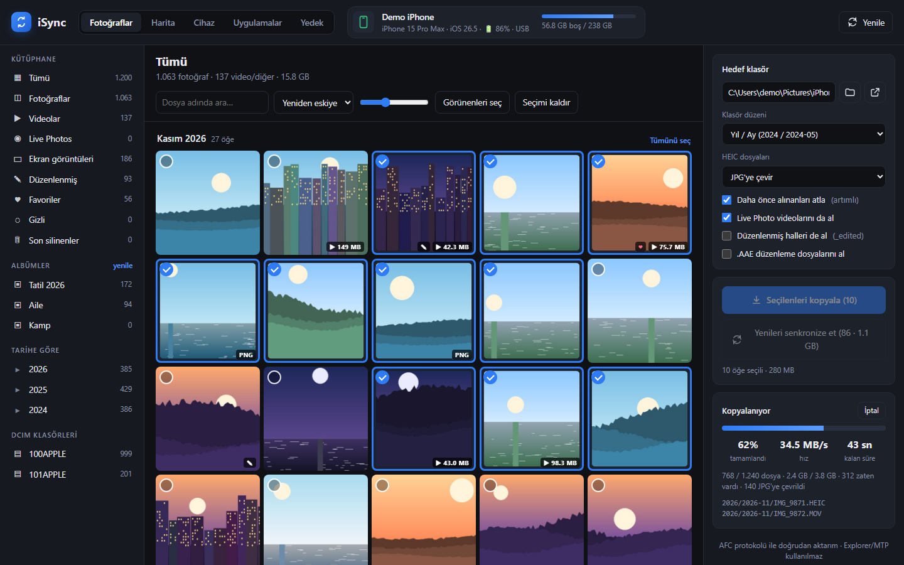
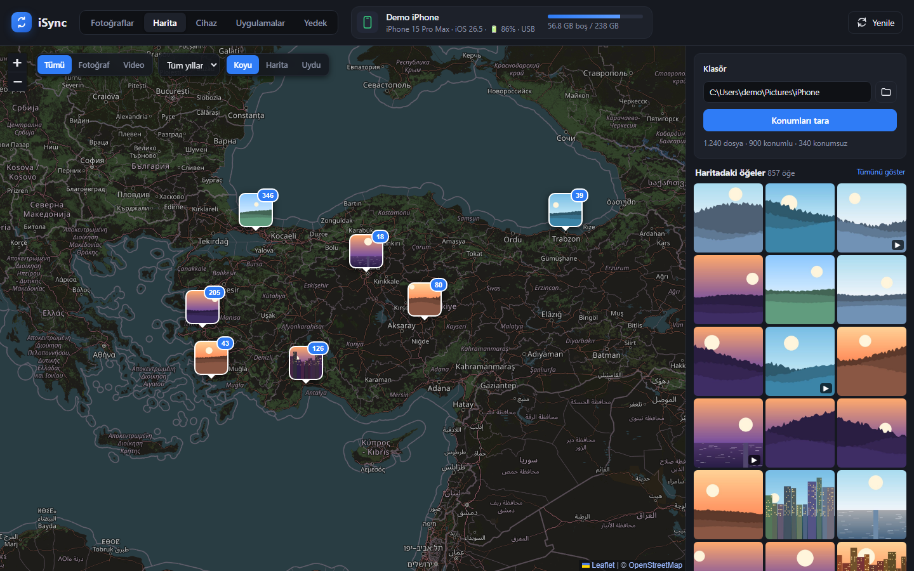
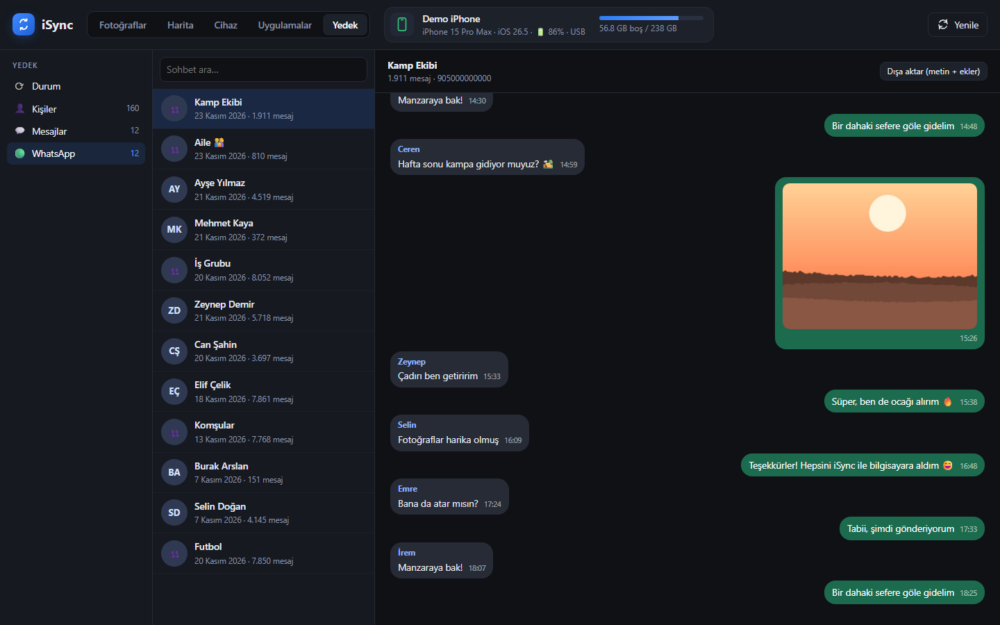
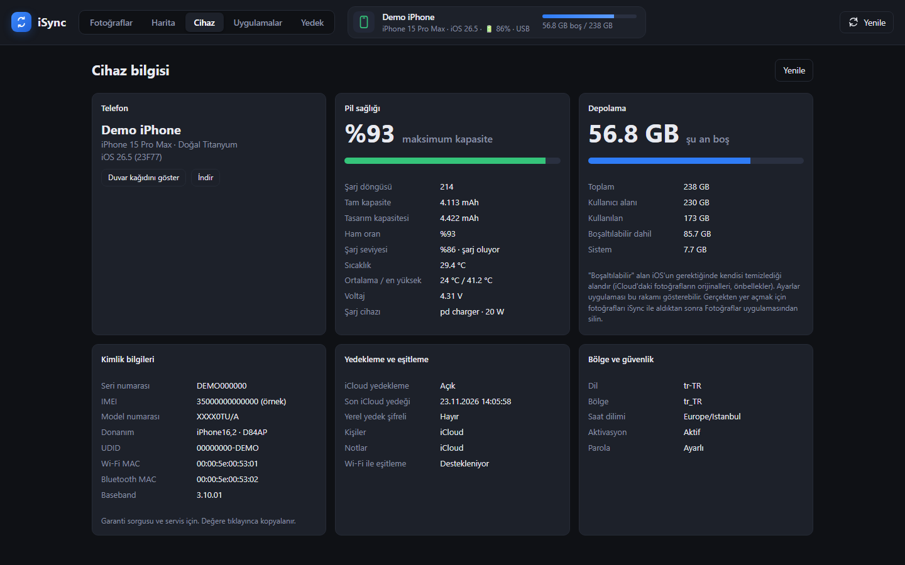
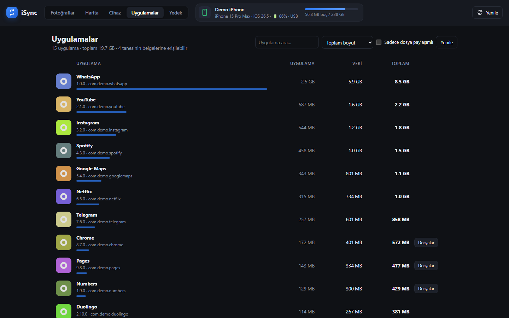
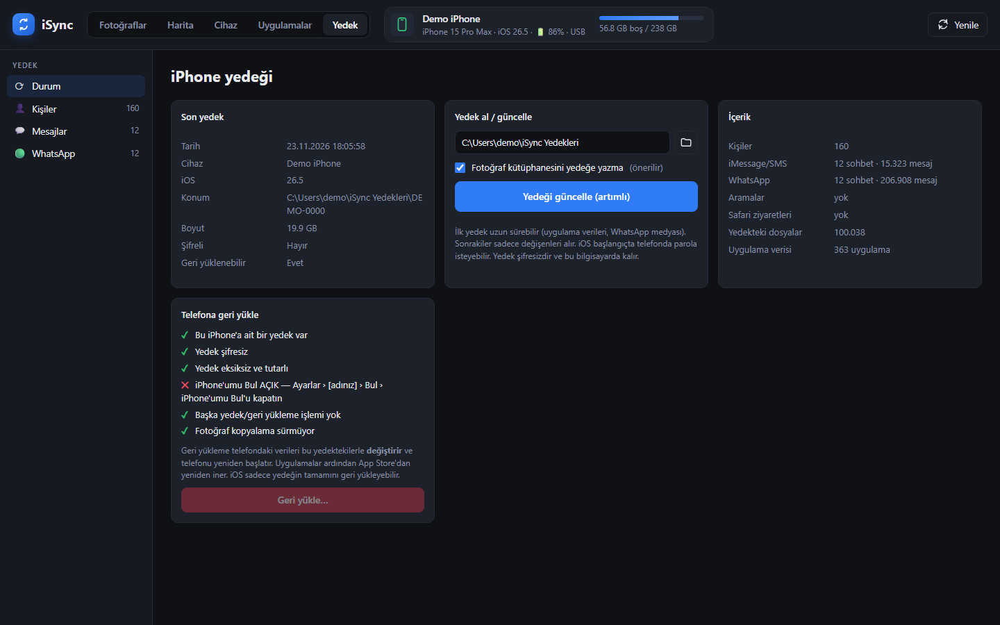
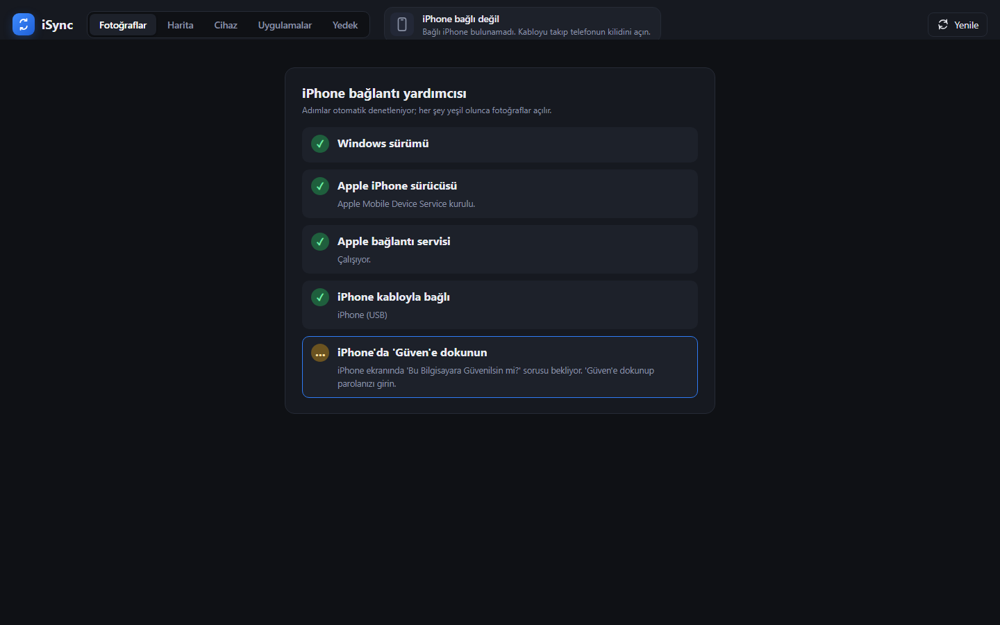

<p align="center"></p>
<h1 align="center">iSync</h1>
<p align="center"><a href="README.md">Türkçe</a> · <b>English</b> · <a href="README.zh-CN.md">简体中文</a></p>
<p align="center"><i>Sync iPhone photos and etc. Smoothly!</i></p>

A **fast** iPhone photo and video transfer tool. It also has a map explorer, device info, backups (contacts, iMessage, WhatsApp) and restore. Runs on Windows, macOS and Linux.
The UI runs in the browser. If Edge or Chrome is installed, it opens as a separate app window without an address bar.

> The app interface is currently in Turkish; the screenshots below show the Turkish UI.



## Screenshots

| Map explorer | WhatsApp backup |
|---|---|
|  |  |
| **Device info and battery health** | **Apps** |
|  |  |
| **Backup and restore** | **Connection assistant** |
|  |  |

> Screenshots were taken in demo mode with **fake data**: images are generated by code; names and messages are made up.

## Download

Download `iSync-Setup-<version>.exe` from the [**Releases**](https://github.com/smlphl/iSync/releases) page and run it. See [Installation](#installation-recommended) below for details.

## Why is it fast?

Windows Explorer talks to the iPhone through the **WPD/MTP** layer. That layer computes the properties of every file in every folder one by one, which is why the system freezes. iSync doesn't use that layer at all. It speaks Apple's own **AFC** protocol directly (the same approach iTools uses):

| Operation | iSync (measured) |
|---|---|
| List 23,323 files in 21 DCIM folders | 0.1 s |
| Size and date of every file | ~4 s |
| Thumbnails (gallery) | ~30 ms each, using the iPhone's own pre-made thumbnails |
| Transfer speed | ~36 MB/s (the limit of a USB 2 cable) |

> **Speed note:** iPhone 15 Pro and later support USB 3 (10 Gbit/s), but the cable in the box is USB 2 (~36 MB/s).
> A USB 3 cable can be faster, but the iPhone doesn't switch to USB 3 reliably: some connections stay at USB 2, even on a Mac.
> Active Thunderbolt 3 cables only run USB 2.0 with plain USB devices.

## Installation (recommended)

**In three steps:**
1. Double-click `iSync-Setup-<version>.exe`. If Windows shows "Windows protected your PC", click **More info › Run anyway**. The warning appears because the app is not digitally signed.
2. Click **Install** (Kur). If Apple's iPhone driver is missing, the "also install the Apple driver automatically" option is pre-checked and the driver is installed too.
3. When iSync opens, the **connection assistant** tells you step by step what to do until the phone connects: cable, unlock, "Trust".

Details:
- **No Python or anything else needs to be installed**; everything is bundled.
- No admin rights needed; it installs to `%LOCALAPPDATA%\Programs\iSync` and adds a Start menu shortcut (and an optional desktop shortcut).
- Uninstall from **Settings › Apps**. Uninstalling doesn't touch your photos, backups or settings (`~/.isync`).
- **Apple driver:** The free "Apple Devices" app is installed from the official Microsoft Store via Windows' `winget` package manager; the Store's terms apply. If `winget` is missing or the install fails, the Store page opens. Apple's driver is not bundled because its license doesn't allow it.
- Silent install: `iSync-Setup-1.0.0.exe --silent [--dir PATH] [--no-desktop] [--no-launch] [--driver]`
- If iSync is already running, launching it again doesn't start a second copy; it shows the open window.
- When the window is closed and no copy or backup is running, the background server shuts itself down within a few minutes.

### Connection assistant
When no phone is connected (on first launch, on "Refresh", or when the phone is unplugged), iSync checks these steps in order:

| Step | What iSync does if there's a problem |
|---|---|
| Windows version | Says Windows 10 1809 or later is required |
| Apple iPhone driver | **"Install Apple driver automatically"** button (Microsoft Store) |
| Apple connection service | **"Start service"** button (asks for Windows approval) |
| iPhone connected by cable | Asks you to plug in the cable, or try another USB port or a data cable. If the phone shows up on USB but isn't recognized, it points out the driver problem. |
| Trust this computer | Asks you to unlock the phone and tap "Trust". If it was declined, explains how to fix it. |

When everything is green, the photos open automatically.

### Troubleshooting
- `iSync.exe --selftest` checks every part of the package (HEIC, crypto, iPhone library, driver status) and writes the result to `~/.isync/selftest.json`.
- Logs: `~/.isync/isync.log`.

To rebuild the installer:
```powershell
powershell -ExecutionPolicy Bypass -File packaging\build.ps1
```

## Running from source (developers)

**Windows:** `iSync.bat` · **macOS / Linux:** `./isync.sh` (Linux needs the `usbmuxd` package)
- Python 3.10 or later
- On Windows: the **Apple Devices** app or iTunes
- The iPhone must be unlocked and "Trust This Computer" must be confirmed

Command-line options: `python -m isync --port 8765 --no-browser --host 0.0.0.0 --auto-exit`

To refresh the README screenshots (demo server with fake data; needs Edge or Chrome):
```powershell
.venv\Scripts\python docs\demo\take_screenshots.py
```

## Features

- **Gallery:** shows 20,000+ photos smoothly (virtualized grid), grouped by month
- **Filters:** Photos, Videos, Live Photos, Screenshots, Edited, Year/Month, DCIM folder, file-name search
- **Albums** ("Albums → load"): reads the iPhone's `Photos.sqlite` database for user albums, favorites, hidden items and **Recently Deleted**, plus the real capture dates. The database is downloaded once (~1 GB, ~30 s) and cached.
- **Preview:** full-resolution photos (HEIC is converted for the browser), video playback, Live Photo video, single-file download
- **Copying:**
  - Copy the selection, or one-click **"Sync new items"** (incremental)
  - Folder layout: Year/Month · Year · iPhone folders · Single folder
  - HEIC → JPG conversion (EXIF preserved; optionally keep the original HEIC too)
  - Optional Live Photo videos, edited versions (`_edited`), .AAE files
  - In an album view, put files in a folder named after the album
  - File dates (created and modified) are set to the capture date
  - Never leaves half-written files (written as `.part`, renamed when done); reconnects automatically if the link drops
  - Different files with the same name are never overwritten; `_1`, `_2` is appended
  - Checks free disk space before starting
- **Incremental sync:** a hidden `.isync/<device>.jsonl` file in the destination records what has been copied. An interrupted job resumes where it stopped.

### Map tab
Shows the photos and videos in your downloaded folder on a map, in thumbnail clusters like Apple Photos.
- Location is read from EXIF GPS in JPG/HEIC files and from the QuickTime location field in MOV/MP4 files. Images aren't decoded, so it's fast: 18,095 files were scanned in 22 seconds.
- The index is saved to `<folder>/.isync/geo.json`. Later scans only read new or changed files.
- Photo/video and year filters. Base map: Dark, Map or Satellite.
- Items in the visible map area are listed in the side panel. In the preview, "Show in folder" opens the file selected in Explorer.
- Video thumbnails come from the iPhone's own thumbnails if the file was copied with iSync.
- The map tiles need internet (OpenStreetMap / Esri).

### Device tab
- **Battery health:** maximum capacity, charge cycles, design and actual mAh, temperature, charger wattage
- **Storage:** truly free space and the space iOS counts as purgeable, shown separately
- **Identity:** serial number, IMEI/IMEI2, model number, UDID, Wi-Fi/Bluetooth MAC (click to copy)
- **Backup:** whether iCloud backup is on, last backup date, source of contacts and notes
- View and download the wallpaper

### Apps tab
- Lists every installed app with icon, version, app size and data size. Sizes are computed on the iPhone, so the first time can take about a minute.
- Browse and download the Documents folder of **file-sharing apps** (Pages, Numbers, Chrome, Lens, Termius…).

### Backup tab (contacts, messages, WhatsApp)
Creates an **unencrypted, incremental** iPhone backup in iTunes/Finder format, then makes its contents readable.
- **Taking a backup:** default location `~/iSync Yedekleri`. The first backup takes a while; later ones only fetch changes. iOS may ask for the passcode on the phone at the start; the UI shows this as an alert.
  The photo library (DCIM/PhotoData) isn't written to the backup by default. If iCloud Photos is on, iOS leaves photos out of the backup anyway.
- **Contacts:** listed with photo, numbers, e-mail, address and birthday; searchable and exportable as **vCard (.vcf)**.
- **Messages (iMessage/SMS)** and **WhatsApp:** chat list and bubble-style chat view. Group chats show the sender's name. Photo, video, voice and file attachments are shown, and numbers are matched to contact names.
  A chat can be exported with "Export" as a text file plus an attachments folder.
- **Call history** and **Safari history** (if iOS includes them in the backup).
- The backup itself is never modified. Databases are copied to `~/.isync/backup-work` before reading.
- Encrypted backups are not supported yet. Health data and Wi-Fi passwords only exist in encrypted backups.

### Restore
**Backup › Status › Restore to phone.** iOS can only restore the **entire** backup; the phone's data is replaced with the backup's and the phone restarts.
- **Requirements** (the UI checks and shows each one):
  - A complete, unencrypted backup of this iPhone
  - **Find My iPhone turned off**
  - No other backup or copy running
- **Safety measures:**
  - You must confirm the warning and type the device name exactly
  - If there's disk space, a copy of the backup is made before the restore starts
  - Once started it can't be interrupted, on purpose, so the phone isn't left in an inconsistent state
- "Keep the phone's current settings" is on by default.
- If the photo library isn't in the backup (the default), photos download again from iCloud Photos. If you don't use iCloud, copy your photos to the computer with iSync first.
- For backups taken without the photo library, the skipped files are also removed from the backup's file list when the backup finishes, so the backup is consistent and restorable.

## License

[Apache License 2.0](LICENSE). The bundled [Leaflet](https://leafletjs.com) (BSD-2) and [Leaflet.markercluster](https://github.com/Leaflet/Leaflet.markercluster) (MIT) for the map are under `isync/static/vendor/` with their own licenses.
