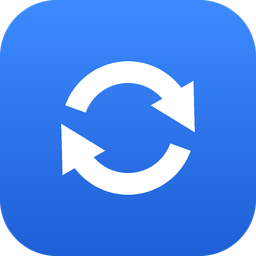
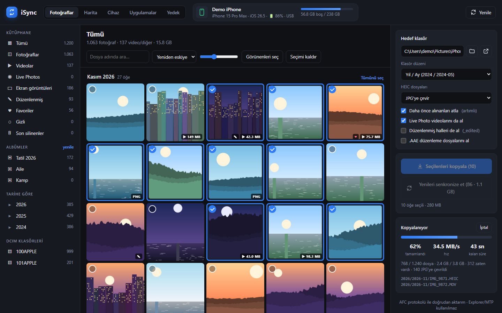
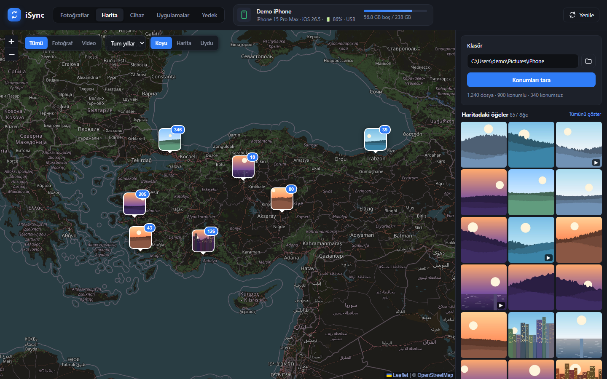
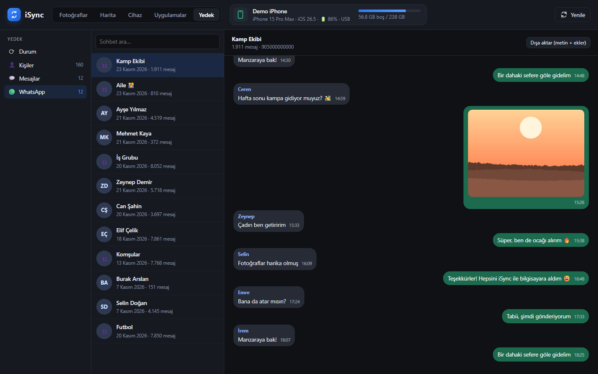
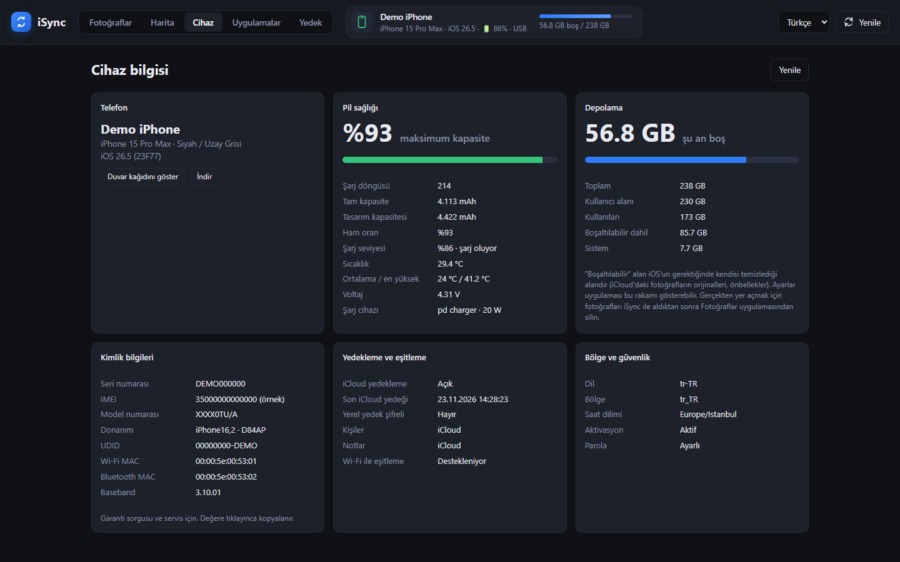
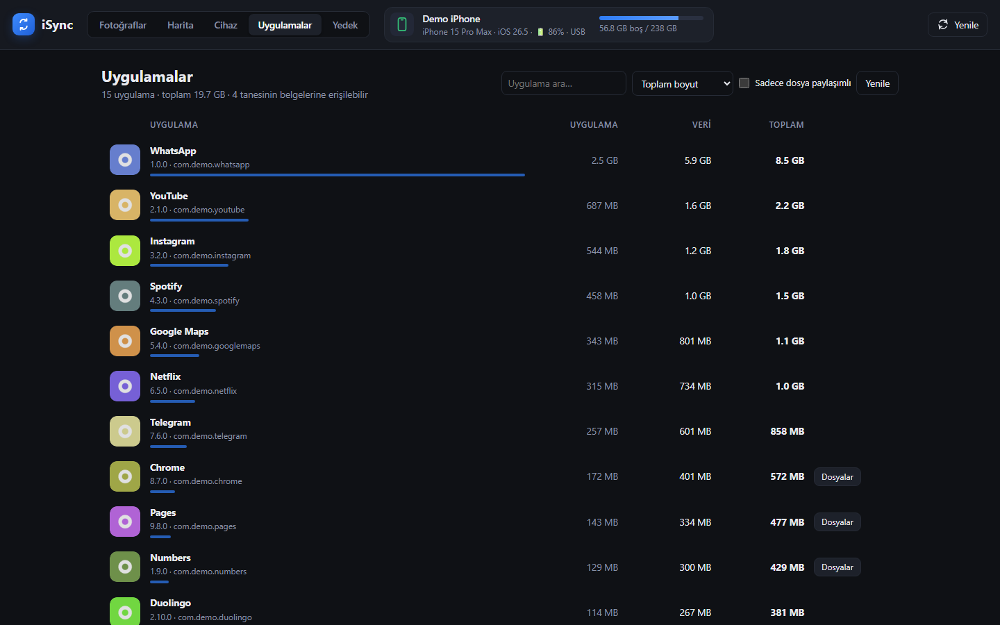
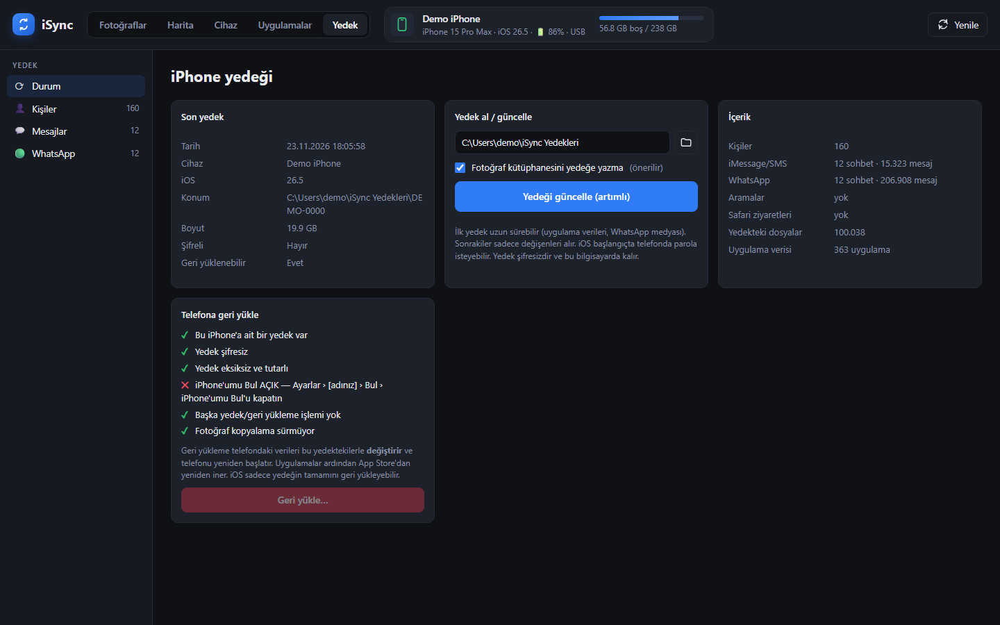
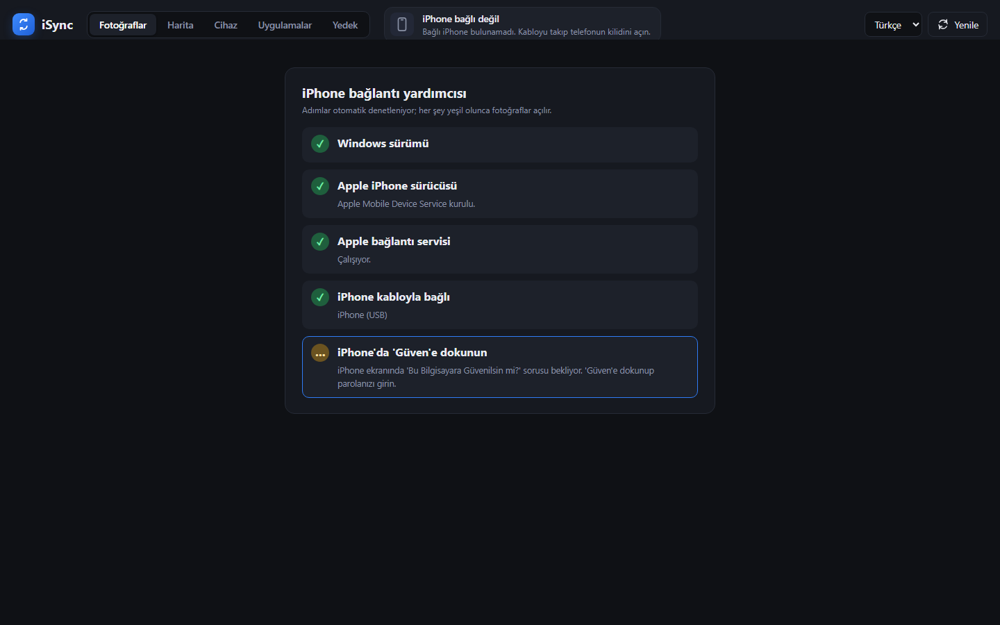

<p align="center"></p>
<h1 align="center">iSync</h1>
<p align="center"><b>Türkçe</b> · <a href="README.en.md">English</a> · <a href="README.zh-CN.md">简体中文</a></p>
<p align="center"><i>Sync iPhone photos and etc. Smoothly!</i></p>

iPhone'daki fotoğraf ve videoları bilgisayara **hızlı** aktaran araç. Harita gezgini, cihaz bilgisi, yedekleme (kişiler, iMessage, WhatsApp) ve geri yükleme de içerir. Windows, macOS ve Linux'ta çalışır.
Arayüz tarayıcıda açılır; Edge/Chrome yüklüyse adres çubuğu olmayan ayrı bir uygulama penceresi olarak gelir.
**Arayüz dilleri:** Türkçe, English, 中文. Sağ üstten değiştirilebilir, ilk açılışta sistem dilinde başlar.



## Ekran görüntüleri

| Harita gezgini | WhatsApp yedeği |
|---|---|
|  |  |
| **Cihaz bilgisi ve pil sağlığı** | **Uygulamalar** |
|  |  |
| **Yedek ve geri yükleme** | **Bağlantı yardımcısı** |
|  |  |

> Ekran görüntüleri demo modunda, **sahte verilerle** çekildi: resimler programla çizildi, isimler ve mesajlar uydurmadır.

## İndir

[**Releases**](https://github.com/smlphl/iSync/releases) sayfasından `iSync-Setup-<sürüm>.exe` dosyasını indir ve çalıştır. Ayrıntılar için aşağıdaki [Kurulum](#kurulum-önerilen) bölümüne bak.

## Neden hızlı?

Windows Explorer iPhone'a **WPD/MTP** katmanıyla bağlanır. Bu katman her klasörde tüm dosyaların
özelliklerini tek tek hesaplar, bu yüzden sistem kilitlenir. iSync bu katmanı hiç kullanmaz; Apple'ın
kendi **AFC** protokolüyle (iTools'un da kullandığı yöntem) doğrudan konuşur:

| İşlem | iSync (ölçülen) |
|---|---|
| 21 DCIM klasöründe 23.323 dosyayı listeleme | 0,1 sn |
| Tüm dosyaların boyut ve tarih bilgisi | ~4 sn |
| Küçük resim (galeri) | ~30 ms/adet, iPhone'un hazır küçük resimleri kullanılır |
| Aktarım hızı | ~36 MB/s (USB 2 kablonun üst sınırı) |

> **Hız notu:** iPhone 15 Pro ve sonrası USB 3 (10 Gbit/s) destekler, ancak kutudan çıkan kablo USB 2'dir (~36 MB/s).
> USB 3 kablo hızı artırabilir, fakat iPhone'un USB 3'e geçişi tutarsızdır: bazı bağlantılarda, Mac'te bile, USB 2'de kalır.
> Thunderbolt 3 aktif kablolar düz USB cihazlarında yalnızca USB 2.0 çalışır.

## Kurulum (önerilen)

**Üç adımda:**
1. `iSync-Setup-<sürüm>.exe` dosyasına çift tıkla. Windows "kişisel bilgisayarınızı korudu" uyarısı gösterirse **Ek bilgi › Yine de çalıştır**'a bas. Uygulama dijital olarak imzalanmadığı için bu uyarı çıkıyor.
2. **Kur**'a bas. Apple'ın iPhone sürücüsü yoksa "Apple sürücüsünü de otomatik kur" seçeneği işaretli gelir ve sürücü de kurulur.
3. iSync açılınca **bağlantı yardımcısı** telefon bağlanana kadar ne yapacağını adım adım söyler: kablo, kilit, "Güven".

Ayrıntılar:
- **Python veya başka hiçbir şeyin yüklü olması gerekmez**; gereken her şey paketin içinde.
- Yönetici izni istemez; `%LOCALAPPDATA%\Programs\iSync` klasörüne kurulur. Başlat menüsüne ve isteğe bağlı olarak masaüstüne kısayol koyar.
- **Ayarlar › Uygulamalar** listesinden kaldırılabilir. Kaldırma fotoğraflara, yedeklere ve ayarlara (`~/.isync`) dokunmaz.
- **Apple sürücüsü:** Ücretsiz "Apple Devices" uygulaması, Windows'un paket yöneticisi `winget` ile resmi Microsoft Store'dan kurulur; Store'un kullanım koşulları geçerlidir. `winget` yoksa ya da kurulum başarısız olursa Store sayfası açılır. Apple'ın sürücüsü lisans gereği pakete konmadı.
- Sessiz kurulum: `iSync-Setup-1.0.0.exe --silent [--dir YOL] [--no-desktop] [--no-launch] [--driver] [--lang tr|en|zh]`
- iSync zaten açıksa tekrar çalıştırmak ikinci bir kopya başlatmaz, açık olan pencereyi gösterir.
- Pencere kapatıldığında, süren bir kopyalama veya yedek yoksa arka plandaki sunucu birkaç dakika içinde kendiliğinden kapanır.
- Kurulum programı Windows diline göre Türkçe, İngilizce ya da Çince açılır; sağ üstteki seçiciden dil değiştirilebilir. Seçilen dil uygulamaya ve kaldırma penceresine de geçer.

### Bağlantı yardımcısı
Telefon bağlı değilse (ilk açılışta, "Yenile"de ya da telefon çıkarılınca) iSync şu adımları sırayla otomatik denetler:

| Adım | Sorun varsa iSync ne yapar |
|---|---|
| Windows sürümü | Windows 10 1809 veya daha yenisi gerektiğini söyler |
| Apple iPhone sürücüsü | **"Apple sürücüsünü otomatik kur"** düğmesi (Microsoft Store) |
| Apple bağlantı servisi | **"Servisi başlat"** düğmesi (Windows onayı ister) |
| iPhone kabloyla bağlı | Kabloyu takmayı, başka USB girişi veya veri taşıyan bir kablo denemeyi söyler. USB'de görünüp tanınmıyorsa sürücü sorununu ayrıca belirtir. |
| Bu bilgisayara güven | Telefonun kilidini açmayı ve "Güven"e dokunmayı söyler. Reddedildiyse ne yapılacağını anlatır. |

Hepsi yeşil olunca fotoğraflar kendiliğinden açılır.

### Sorun giderme
- `iSync.exe --selftest` paketin tüm parçalarını (HEIC, şifreleme, iPhone kütüphanesi, sürücü durumu) denetler ve sonucu `~/.isync/selftest.json` dosyasına yazar.
- Günlük kayıtları: `~/.isync/isync.log`.

Kurulum dosyasını yeniden üretmek için:
```powershell
powershell -ExecutionPolicy Bypass -File packaging\build.ps1
```

## Kaynaktan çalıştırma (geliştirici)

**Windows:** `iSync.bat` · **macOS / Linux:** `./isync.sh` (Linux'ta `usbmuxd` paketi gerekir)
- Python 3.10 veya üstü
- Windows'ta **Apple Devices** uygulaması veya iTunes
- iPhone'un kilidi açık olmalı ve "Bu Bilgisayara Güven" onaylanmış olmalı

Komut satırı seçenekleri: `python -m isync --port 8765 --no-browser --host 0.0.0.0 --auto-exit`

**Çeviriler:** Arayüz metinlerinin kaynağı Türkçedir. Çeviriler `isync/static/i18n/en.json` ve `zh.json` dosyalarındadır; anahtar, arayüzdeki Türkçe metnin kendisidir. `{}` değişken kısımları gösterir. Yeni metin ekledikten sonra eksik çevirileri görmek için:
```powershell
.venv\Scripts\python tools\i18n_extract.py
```

README ekran görüntülerini (üç dilde) yenilemek için (sahte verilerle çalışan demo sunucusu, Edge veya Chrome gerekir):
```powershell
.venv\Scripts\python docs\demo\take_screenshots.py
```

## Özellikler

- **Galeri:** 20 binden fazla fotoğrafı takılmadan gösterir (sanal ızgara), aylara göre gruplar
- **Filtreler:** Fotoğraflar, Videolar, Live Photos, Ekran görüntüleri, Düzenlenmiş, Yıl/Ay, DCIM klasörü, dosya adında arama
- **Albümler** ("Albümler → yükle"): iPhone'un `Photos.sqlite` veritabanını okur. Kullanıcı albümlerini,
  favorileri, gizlileri ve **Son Silinenler**'i getirir; gerçek çekim tarihlerini de buradan alır.
  Veritabanı bir kez indirilir (~1 GB, ~30 sn) ve önbellekte tutulur.
- **Önizleme:** Orijinal çözünürlükte foto (HEIC tarayıcı için dönüştürülür), video oynatma, Live Photo videosu, tek dosya indirme
- **Kopyalama:**
  - Seçilenleri kopyala, ya da tek tıkla **"Yenileri senkronize et"** (artımlı)
  - Klasör düzeni: Yıl/Ay · Yıl · iPhone klasörleri · Tek klasör
  - HEIC → JPG dönüştürme (EXIF korunur; isterseniz orijinal HEIC de saklanır)
  - Live Photo videoları, düzenlenmiş haller (`_edited`), .AAE dosyaları isteğe bağlı
  - Albüm görünümündeyken albüm adıyla klasöre koyma
  - Dosya tarihleri (oluşturma ve değiştirme) çekim tarihine ayarlanır
  - Yarım dosya bırakmaz (`.part` olarak yazılır, bitince yeniden adlandırılır). Kopma olursa otomatik yeniden bağlanır.
  - Aynı adlı farklı dosyalar ezilmez, sonuna `_1`, `_2` eklenir
  - Başlamadan önce boş disk alanını kontrol eder
- **Artımlı senkronizasyon:** Hedef klasördeki gizli `.isync/<cihaz>.jsonl` dosyası neyin alındığını kaydeder.
  Yarıda kalan bir iş tekrar başlatıldığında kaldığı yerden devam eder.

### Harita sekmesi
İndirdiğin klasördeki fotoğraf ve videoları Apple Fotoğraflar'daki gibi harita üzerinde, küçük resimli kümeler halinde gösterir.
- Konum, JPG/HEIC dosyalarında EXIF GPS'ten, MOV/MP4 dosyalarında QuickTime konum alanından okunur. Görüntü çözülmez, bu yüzden hızlıdır: 18.095 dosya 22 saniyede tarandı.
- İndeks `<klasör>/.isync/geo.json` dosyasına yazılır. Sonraki taramalarda sadece yeni veya değişen dosyalar okunur.
- Fotoğraf/video ve yıl filtresi var. Altlık olarak Koyu, Harita ve Uydu seçilebilir.
- Haritada görünen alandaki öğeler yan panelde listelenir. Önizlemede "Klasörde göster" düğmesi dosyayı Explorer'da seçili açar.
- Videoların küçük resimleri, iSync ile alındıysa iPhone'un kendi küçük resimlerinden gelir.
- Harita altlıkları için internet gerekir (OpenStreetMap / Esri).

### Cihaz sekmesi
- **Pil sağlığı:** maksimum kapasite, şarj döngüsü, tasarım ve gerçek mAh, sıcaklık, şarj cihazının gücü
- **Depolama:** şu an gerçekten boş olan alan ve iOS'un boşaltılabilir saydığı alan ayrı ayrı gösterilir
- **Kimlik:** seri numarası, IMEI/IMEI2, model numarası, UDID, Wi-Fi/Bluetooth MAC (tıklayınca kopyalanır)
- **Yedekleme:** iCloud yedeği açık mı, son yedeğin tarihi, kişi ve notların kaynağı
- Duvar kağıdını görüntüleme ve indirme

### Uygulamalar sekmesi
- Yüklü tüm uygulamalar ikonları, sürümleri, uygulama ve veri boyutlarıyla listelenir. Boyutlar iPhone'da hesaplanır, bu yüzden ilk seferde bir dakika kadar sürebilir.
- **Dosya paylaşımlı uygulamaların** (Pages, Numbers, Chrome, Lens, Termius…) Belgeler klasörünü gezip dosya indirebilirsin.

### Yedek sekmesi (kişiler, mesajlar, WhatsApp)
iTunes/Finder biçiminde, **şifresiz ve artımlı** bir iPhone yedeği alır, sonra içindeki verileri okunur hale getirir.
- **Yedek alma:** Varsayılan konum `~/iSync Yedekleri`. İlk yedek uzun sürer; sonrakiler sadece değişenleri alır. iOS başlangıçta telefonda parola isteyebilir, arayüz bunu uyarı olarak gösterir.
  Fotoğraf kütüphanesi (DCIM/PhotoData) varsayılan olarak yedeğe yazılmaz. Zaten iCloud Fotoğraflar açıksa iOS fotoğrafları yedeğe hiç koymaz.
- **Kişiler:** fotoğraf, numara, e-posta, adres ve doğum günü ile listelenir; arama yapılabilir ve **vCard (.vcf)** olarak dışa aktarılabilir.
- **Mesajlar (iMessage/SMS)** ve **WhatsApp:** sohbet listesi ve baloncuklu sohbet görünümü. Grup sohbetlerinde gönderen adı görünür. Fotoğraf, video, sesli mesaj ve dosya ekleri gösterilir; numaralar kişi adlarıyla eşleştirilir.
  Bir sohbet "Dışa aktar" ile metin dosyası ve ekler klasörü olarak kaydedilebilir.
- **Arama geçmişi** ve **Safari geçmişi** (iOS bu verileri yedeğe koyuyorsa).
- Yedeğin kendisine hiç yazılmaz. Veritabanları okunmadan önce `~/.isync/backup-work` klasörüne kopyalanır.
- Şifreli yedekler henüz desteklenmiyor. Sağlık verileri ve Wi-Fi şifreleri sadece şifreli yedekte bulunur.

### Geri yükleme
**Yedek › Durum › Telefona geri yükle.** iOS sadece yedeğin **tamamını** geri yükleyebilir; telefondaki veriler yedektekilerle değiştirilir ve telefon yeniden başlar.
- **Ön koşullar** (arayüz her birini kontrol edip gösterir):
  - Bu iPhone'a ait, eksiksiz ve şifresiz bir yedek olmalı.
  - **iPhone'umu Bul kapalı** olmalı.
  - Süren başka bir yedek veya kopyalama olmamalı.
- **Güvenlik önlemleri:**
  - Uyarıyı onaylaman ve cihaz adını aynen yazman istenir.
  - Diskte yer varsa yedeğin bir kopyası alındıktan sonra geri yükleme başlar.
  - İşlem başladıktan sonra yarıda kesilemez; telefon tutarsız kalmasın diye bu bilerek böyle.
- "Telefonun mevcut ayarlarını koru" seçeneği varsayılan olarak açıktır.
- Fotoğraf kütüphanesi yedekte yoksa (varsayılan) fotoğraflar iCloud Fotoğraflar'dan yeniden iner. iCloud kullanmıyorsan önce fotoğrafları iSync ile bilgisayara al.
- Fotoğraf atlanarak alınan yedeklerde, atlanan dosyalar yedek bitince içindekiler listesinden de çıkarılır. Böylece yedek tutarlı ve geri yüklenebilir olur.

## Lisans

[Apache License 2.0](LICENSE). Harita için gömülü [Leaflet](https://leafletjs.com) (BSD-2) ve [Leaflet.markercluster](https://github.com/Leaflet/Leaflet.markercluster) (MIT) kendi lisanslarıyla `isync/static/vendor/` altındadır.
