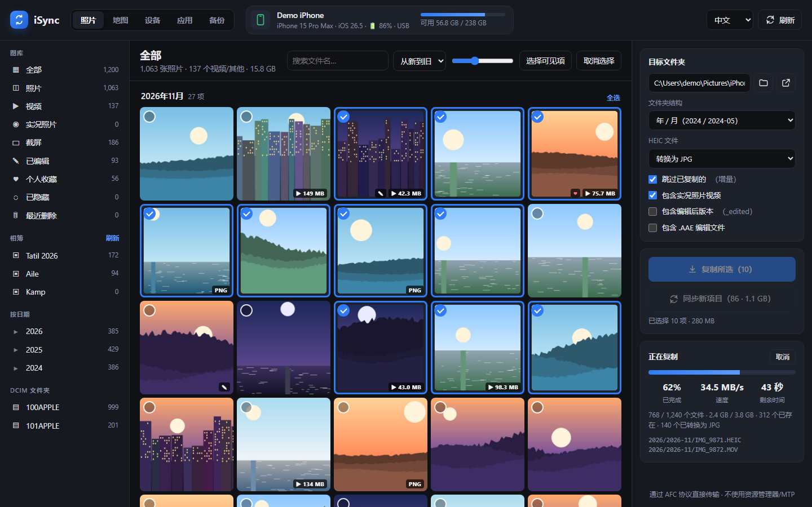
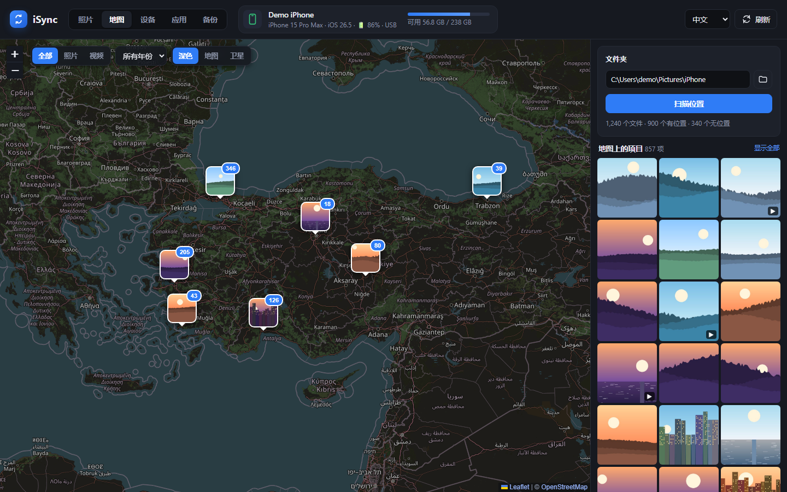
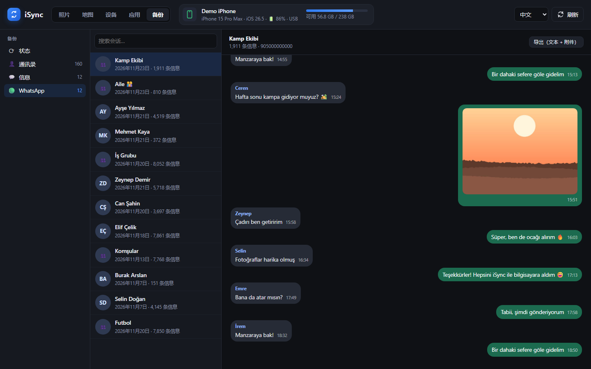
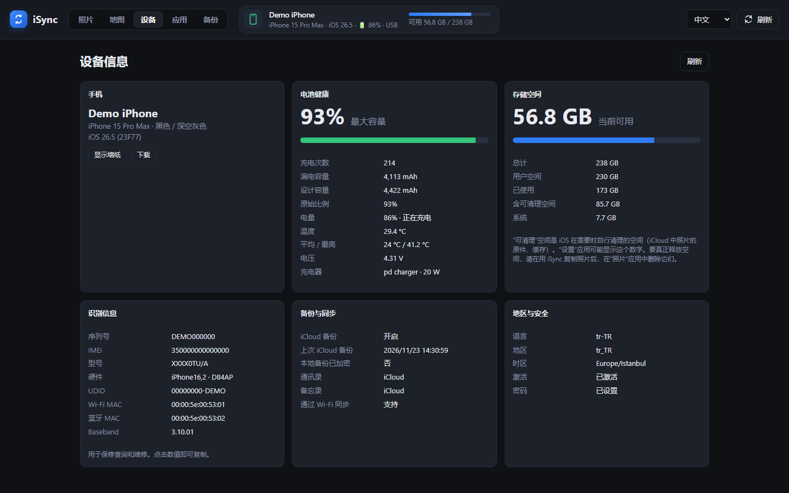
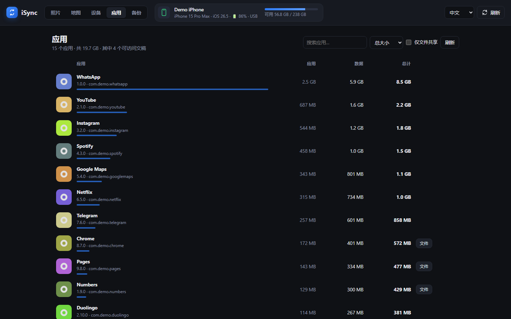
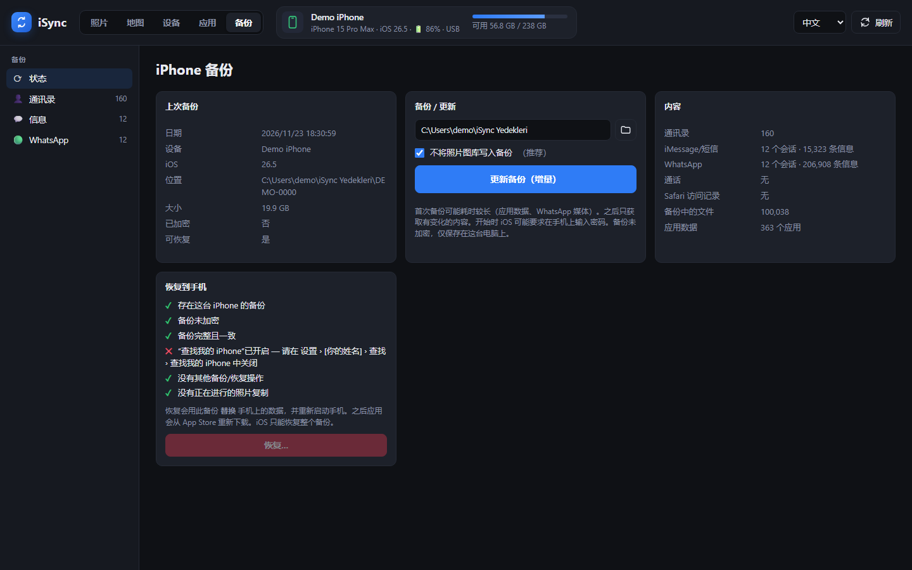
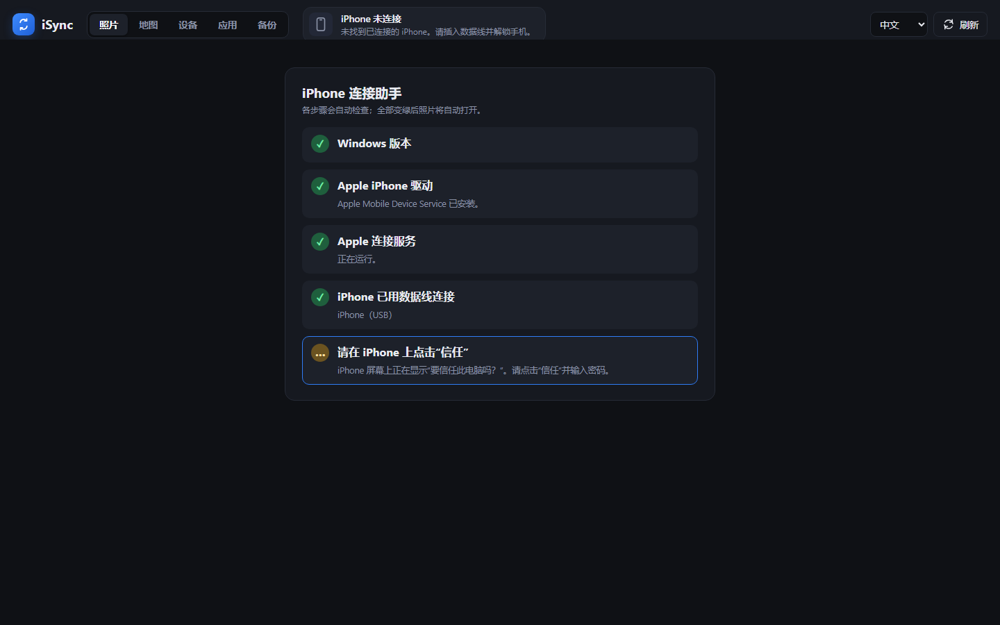

<p align="center"></p>
<h1 align="center">iSync</h1>
<p align="center"><a href="README.md">Türkçe</a> · <a href="README.en.md">English</a> · <b>简体中文</b></p>
<p align="center"><i>Sync iPhone photos and etc. Smoothly!</i></p>

一款**快速**的 iPhone 照片和视频传输工具，还提供地图浏览、设备信息、备份（通讯录、iMessage、WhatsApp）和恢复功能。支持 Windows、macOS 和 Linux。
界面在浏览器中运行；如果安装了 Edge 或 Chrome，会以不带地址栏的独立应用窗口打开。
**界面语言：** Türkçe、English、中文 —— 可在右上角切换，默认跟随系统语言。



## 截图

| 地图浏览 | WhatsApp 备份 |
|---|---|
|  |  |
| **设备信息与电池健康** | **应用** |
|  |  |
| **备份与恢复** | **连接助手** |
|  |  |

> 截图在演示模式下使用**虚构数据**拍摄：图片由程序生成，姓名和消息均为虚构。

## 下载

在 [**Releases**](https://github.com/smlphl/iSync/releases) 页面下载 `iSync-Setup-<版本>.exe` 并运行。详见下方[安装](#安装推荐)部分。

## 为什么这么快？

Windows 资源管理器通过 **WPD/MTP** 层访问 iPhone。该层会逐个计算每个文件夹中所有文件的属性，因此系统会卡死。iSync 完全不使用该层，而是直接使用 Apple 自己的 **AFC** 协议（iTools 也采用这种方式）：

| 操作 | iSync（实测） |
|---|---|
| 列出 21 个 DCIM 文件夹中的 23,323 个文件 | 0.1 秒 |
| 获取所有文件的大小和日期 | 约 4 秒 |
| 缩略图（图库） | 每张约 30 毫秒，直接使用 iPhone 自带的缩略图 |
| 传输速度 | 约 36 MB/s（USB 2 数据线的上限） |

> **速度说明：** iPhone 15 Pro 及更新机型支持 USB 3（10 Gbit/s），但随附的数据线是 USB 2（约 36 MB/s）。
> USB 3 数据线可能更快，但 iPhone 切换到 USB 3 并不稳定：即使在 Mac 上，部分连接也会停留在 USB 2。
> 主动式（active）雷雳 3 数据线连接普通 USB 设备时只能以 USB 2.0 工作。

## 安装（推荐）

**三步完成：**
1. 双击 `iSync-Setup-<版本>.exe`。如果 Windows 显示"Windows 已保护你的电脑"，请点击**更多信息 › 仍要运行**。出现此提示是因为应用没有数字签名。
2. 点击**安装**。如果缺少 Apple 的 iPhone 驱动，"同时自动安装 Apple 驱动"选项会默认勾选，驱动也会一并安装。
3. iSync 打开后，**连接助手**会一步步告诉你该做什么，直到手机连接成功：数据线、解锁、"信任"。

详细说明：
- **无需安装 Python 或任何其他软件**，所需内容都已打包。
- 无需管理员权限；安装到 `%LOCALAPPDATA%\Programs\iSync`，并添加开始菜单快捷方式（可选桌面快捷方式）。
- 可在**设置 › 应用**中卸载。卸载不会影响你的照片、备份和设置（`~/.isync`）。
- **Apple 驱动：** 通过 Windows 包管理器 `winget` 从官方 Microsoft Store 安装免费的"Apple Devices"应用，适用 Store 的使用条款。如果没有 `winget` 或安装失败，会打开 Store 页面。由于许可证限制，Apple 驱动未打包在安装程序中。
- 静默安装：`iSync-Setup-1.0.0.exe --silent [--dir 路径] [--no-desktop] [--no-launch] [--driver] [--lang tr|en|zh]`
- 如果 iSync 已在运行，再次启动不会打开第二个实例，而是显示已打开的窗口。
- 关闭窗口后，如果没有正在进行的复制或备份，后台服务器会在几分钟内自动退出。
- 安装程序默认使用 Windows 语言（土耳其语、英语或中文），右上角可切换语言。所选语言会同步到应用和卸载程序。

### 连接助手
当没有连接手机时（首次启动、点击"刷新"或拔出手机时），iSync 会依次自动检查以下步骤：

| 步骤 | 出现问题时 iSync 的处理 |
|---|---|
| Windows 版本 | 提示需要 Windows 10 1809 或更高版本 |
| Apple iPhone 驱动 | **"自动安装 Apple 驱动"**按钮（Microsoft Store） |
| Apple 连接服务 | **"启动服务"**按钮（需要 Windows 确认） |
| iPhone 已用数据线连接 | 提示插入数据线，或尝试其他 USB 接口、可传输数据的数据线。如果手机在 USB 上可见但无法识别，会单独指出驱动问题。 |
| 信任此电脑 | 提示解锁手机并点击"信任"。如果之前选择了不信任，会说明如何修复。 |

全部变绿后，照片会自动打开。

### 故障排除
- `iSync.exe --selftest` 会检查软件包的所有组件（HEIC、加密库、iPhone 库、驱动状态），并将结果写入 `~/.isync/selftest.json`。
- 日志：`~/.isync/isync.log`。

重新构建安装程序：
```powershell
powershell -ExecutionPolicy Bypass -File packaging\build.ps1
```

## 从源码运行（开发者）

**Windows：** `iSync.bat` · **macOS / Linux：** `./isync.sh`（Linux 需要 `usbmuxd` 软件包）
- Python 3.10 或更高版本
- Windows 上需要 **Apple Devices** 应用或 iTunes
- iPhone 必须已解锁，并已确认"信任此电脑"

命令行选项：`python -m isync --port 8765 --no-browser --host 0.0.0.0 --auto-exit`

更新 README 截图（使用虚构数据的演示服务器；需要 Edge 或 Chrome）：
```powershell
.venv\Scripts\python docs\demo\take_screenshots.py
```

## 功能

- **图库：** 流畅显示 2 万张以上照片（虚拟化网格），按月分组
- **筛选：** 照片、视频、实况照片、截屏、已编辑、年/月、DCIM 文件夹、按文件名搜索
- **相簿**（"相簿 → 加载"）：读取 iPhone 的 `Photos.sqlite` 数据库，获取用户相簿、个人收藏、已隐藏和**最近删除**，以及真实的拍摄日期。数据库只下载一次（约 1 GB，约 30 秒）并缓存。
- **预览：** 原始分辨率照片（HEIC 会为浏览器转换）、视频播放、实况照片视频、单文件下载
- **复制：**
  - 复制所选内容，或一键**"同步新项目"**（增量）
  - 文件夹结构：年/月 · 年 · iPhone 文件夹 · 单一文件夹
  - HEIC → JPG 转换（保留 EXIF；可选同时保留原始 HEIC）
  - 可选：实况照片视频、编辑后版本（`_edited`）、.AAE 文件
  - 在相簿视图中，可放入以相簿命名的文件夹
  - 文件日期（创建和修改）设置为拍摄日期
  - 不会留下写了一半的文件（先写为 `.part`，完成后重命名）；连接中断时自动重连
  - 同名的不同文件不会被覆盖，会追加 `_1`、`_2`
  - 开始前检查可用磁盘空间
- **增量同步：** 目标文件夹中隐藏的 `.isync/<设备>.jsonl` 文件记录已复制的内容。中断的任务重新开始时会从中断处继续。

### 地图标签页
像 Apple 照片一样，在地图上以带缩略图的聚合点显示已下载文件夹中的照片和视频。
- 位置信息从 JPG/HEIC 的 EXIF GPS 以及 MOV/MP4 的 QuickTime 位置字段读取。不解码图像，因此速度很快：22 秒扫描了 18,095 个文件。
- 索引保存在 `<文件夹>/.isync/geo.json`，之后的扫描只读取新增或更改的文件。
- 支持照片/视频和年份筛选；底图可选深色、地图或卫星。
- 侧边栏列出当前地图范围内的项目。预览中的"在文件夹中显示"会在资源管理器中选中该文件。
- 如果视频是通过 iSync 复制的，其缩略图来自 iPhone 自带的缩略图。
- 地图底图需要联网（OpenStreetMap / Esri）。

### 设备标签页
- **电池健康：** 最大容量、充电次数、设计容量与实际容量（mAh）、温度、充电器功率
- **存储：** 分别显示真正可用的空间和 iOS 认为可清理的空间
- **识别信息：** 序列号、IMEI/IMEI2、型号、UDID、Wi-Fi/蓝牙 MAC（点击即可复制）
- **备份：** iCloud 备份是否开启、上次备份时间、通讯录和备忘录的来源
- 查看和下载墙纸

### 应用标签页
- 列出所有已安装应用的图标、版本、应用大小和数据大小。大小由 iPhone 计算，首次可能需要约一分钟。
- 可浏览并下载**支持文件共享的应用**（Pages、Numbers、Chrome、Lens、Termius 等）的"文稿"文件夹。

### 备份标签页（通讯录、信息、WhatsApp）
以 iTunes/Finder 格式创建**未加密的增量** iPhone 备份，并使其中的数据可读。
- **创建备份：** 默认位置为 `~/iSync Yedekleri`。首次备份耗时较长，之后只获取有变化的内容。iOS 可能会在开始时要求在手机上输入密码，界面会以提示形式显示。
  默认不将照片图库（DCIM/PhotoData）写入备份。如果开启了 iCloud 照片，iOS 本身也不会把照片放入备份。
- **通讯录：** 显示头像、号码、电子邮件、地址和生日；可搜索，并可导出为 **vCard (.vcf)**。
- **信息（iMessage/短信）**和 **WhatsApp：** 会话列表和气泡式聊天视图。群聊中显示发送者姓名。显示照片、视频、语音和文件附件，号码会与联系人姓名匹配。
  可通过"导出"将会话保存为文本文件和附件文件夹。
- **通话记录**和 **Safari 历史记录**（如果 iOS 将其放入备份）。
- 绝不修改备份本身。读取前会将数据库复制到 `~/.isync/backup-work`。
- 暂不支持加密备份。健康数据和 Wi-Fi 密码只存在于加密备份中。

### 恢复
**备份 › 状态 › 恢复到手机。** iOS 只能恢复**整个**备份；手机上的数据会被备份中的数据替换，然后手机会重新启动。
- **前提条件**（界面会逐项检查并显示）：
  - 有一份属于这台 iPhone 的完整、未加密的备份
  - **已关闭"查找我的 iPhone"**
  - 没有其他正在进行的备份或复制
- **安全措施：**
  - 需要确认警告，并准确输入设备名称
  - 如果磁盘空间足够，会先复制一份备份再开始恢复
  - 开始后无法中断（这是有意为之，以免手机处于不一致状态）
- "保留手机当前设置"选项默认开启。
- 如果备份中不含照片图库（默认情况），照片会从 iCloud 照片重新下载。如果不使用 iCloud，请先用 iSync 将照片复制到电脑。
- 对于不含照片图库的备份，备份完成时会将跳过的文件也从备份的文件清单中移除，使备份保持一致且可恢复。

## 许可证

[Apache License 2.0](LICENSE)。地图所用的 [Leaflet](https://leafletjs.com)（BSD-2）和 [Leaflet.markercluster](https://github.com/Leaflet/Leaflet.markercluster)（MIT）以各自的许可证存放在 `isync/static/vendor/` 下。
